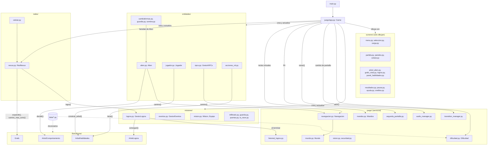
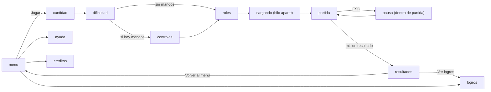
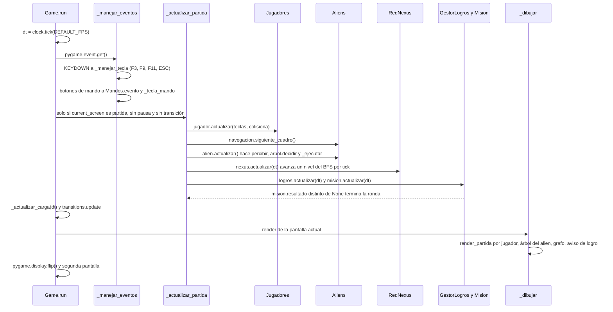
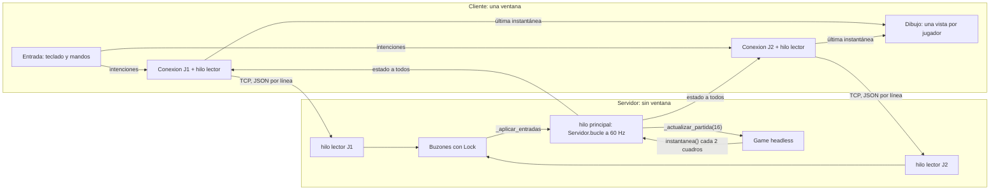

# Arquitectura de NEXUS

Cómo están repartidos los módulos del juego, cómo se hablan entre ellos y qué
pasa en cada cuadro. Al final está el modo en red, que vive en otra rama.

## Módulos principales

`main.py` solo se pone en la carpeta del proyecto (para que las rutas de
imágenes y mapas funcionen desde cualquier lado) y llama `Game().run()`. Todo
lo demás cuelga de la clase `Game` de `juego/app.py`, que es la dueña de la
partida: tiene la lista de jugadores, los aliens, el mundo, la misión, la red
NEXUS, los logros, la pausa y la pantalla actual (`current_screen`).

Los módulos no se llaman entre ellos por su cuenta: `Game` los crea al armar
la partida (`_preparar_partida`) y les pasa lo que necesitan en cada cuadro.
Cuando un módulo necesita algo del juego (por ejemplo, `RedNexus` necesita los
aliens para avisarle al más cercano), recibe el `Game` en su constructor y lo
consulta con `getattr`, así las pruebas pueden armar partidas a mano sin todas
las piezas.



Algunas cosas que el diagrama no alcanza a mostrar:

- `screens/` no guarda estado de juego: cada función `render_*` recibe la
  pantalla y lo que tiene que pintar (`render_partida`, `render_arbol_alien`,
  `render_grafo_nexus`...). La excepción es lo que se calcula solo para
  dibujar, como la disposición por fuerzas del grafo en `grafo_vista.py`.
- `data/` son diccionarios y constantes. De ahí salen los cuatro árboles de
  comportamiento, los árboles de habilidades, el árbol de logros, las cuentas
  y rumores de NEXUS, los tipos de alien y los números de la dificultad.
- `juego/mandos.py` traduce cada botón de mando a una "tecla virtual". Así el
  resto del juego solo pregunta por teclas: `Game` envuelve
  `pygame.key.get_pressed()` con `Mandos.envolver()` y los botones que se
  presionan una vez llegan como si fueran un KEYDOWN.
- `juego/dificultad.py` no cambia los módulos: cada uno le pregunta su número
  con `dificultad.valor(juego, nombre, por_defecto)`. En Inteligente,
  `Dificultad.actualizar` mueve el nivel cada 4 s y las respuestas cambian
  solas.
- `juego/transition_manager.py` hace el fundido a negro al cambiar de
  pantalla (`transitions.request(game, "cargando")`) y mientras dura no
  se procesan teclas.
- `juego/segunda_pantalla.py` abre una segunda ventana con F9: con 3 o 4
  jugadores, J1 y J2 se quedan en la ventana principal y J3 y J4 van a la
  otra. Con 2 jugadores la segunda ventana repite la principal.

### Flujo de pantallas

`current_screen` va pasando por estos valores:



`Game.empezar_carga` arma la partida en un `threading.Thread` (el hilo llama
`_preparar_partida`) para que la animación del Cambiaformas persiguiendo al
Tecnomante no se congele; la pantalla dura al menos `MIN_CARGA_MS = 2000`.
Sin ventana (las pruebas, con `SDL_VIDEODRIVER=dummy`) no hay hilo: llama
`iniciar_partida()` de una. La pausa no es otra pantalla: es `self.pausa`
(`juego/pausa.py: MenuPausa`) y, mientras existe, la partida no se actualiza.

## El bucle de un cuadro

`Game.run()` corre a `DEFAULT_FPS = 60` (`juego/config.py`) con `clock.tick`. Cada vuelta hace tres
cosas en orden: eventos, actualizar y dibujar.



Dentro de `_actualizar_partida` el orden importa:

1. Si hay una ventana de presentación de alien abierta, solo se actualiza esa
   y se sale (todo queda quieto hasta que alguien la cierra).
2. `teclas = self.mandos.envolver(pygame.key.get_pressed())`, el tutorial y
   cada `jugador.actualizar(...)`, lo que se mantiene (consolas, reparación,
   cajas de fusibles) y las pistas de la flecha.
3. Puertas para dos, `acciones_rol.actualizar`, el Guardia y la planta.
4. `navegacion.siguiente_cuadro()` (para repartir los caminos largos entre
   cuadros) y la Sombra.
5. Si ya terminó el tutorial: el director de la dificultad, los ajustes de
   velocidad, visión y oído de cada alien, `alien.actualizar(...)` de cada uno
   y los eventos de la nave (apagón, alarma, compuertas).
6. Prisioneros (`npcs.actualizar`), NEXUS (`nexus.actualizar`, y el feed del
   celular si está abierto), minijuegos de escondite, pulso, salas, ambiente,
   logros y la presentación de aliens nuevos.
7. `mision.actualizar(dt)`. Si deja un `resultado`, se llama
   `terminar_ronda()` y se pasa a resultados.

Con F3 se ve cuánto tarda cada parte: `_medir_cuadro` muestra los FPS y los
ms de actualizar y dibujar, y `juego/diagnostico.py` anota los cuadros de más
de 40 ms en la consola y en `Guardado/tirones.txt`.

## Modo en red (cliente-servidor)

Este modo **no está en `main`**: vive en la rama `claude/cliente-servidor`
(su propio PR) con la carpeta `cliente_servidor/` y el diseño en
`docs/cliente_servidor.md` de esa rama. Lo resumimos aquí para que la
arquitectura quede completa. El modo local (`python main.py`) no cambia.

La idea es que un **servidor** sin ventana sea el dueño de la partida y que el
**cliente** solo lea la entrada y dibuje.

- El servidor (`cliente_servidor/servidor.py`, clase `Servidor`) crea un
  `Game()` con `SDL_VIDEODRIVER=dummy`, arma la partida saltándose los menús y
  corre `_actualizar_partida(16)` a 60 Hz fijos en su hilo principal. Es el
  único que toca el `Game`.
- Hay **una conexión TCP por jugador**, aunque estén todos en la misma
  ventana. Por cada conexión hay un hilo lector que deja la última intención
  en un `Buzon` protegido con `threading.Lock`.
- Los mensajes son un objeto JSON por línea (`cliente_servidor/protocolo.py`):
  `hola`, `bienvenida`, `espera`, `intencion`, `estado`, `adios` y `error`.
  La intención lleva acciones por nombre (`mantener`: arriba, abajo, sigilo,
  interactuar...; `pulsar`: habilidad, celular, soltar...), no teclas.
- Para no tocar `app.py`, el servidor cambia `g.mandos.envolver` en su
  instancia por una función que devuelve las teclas del puesto de cada
  jugador según lo que mandaron los clientes, y lo pulsado lo pasa a
  `Game._tecla_en_partida(tecla)`.
- Cada 2 cuadros (30 Hz) manda la misma instantánea (`estado`) a todas las
  conexiones: posiciones, vidas, panel abierto, aliens con su acción y su
  cono, fase de la misión, y el `ack` de la última intención de cada uno.
- El cliente (`cliente_servidor/cliente.py`) abre **una sola ventana**
  (el teclado solo le llega a la ventana con foco) dividida en una vista por
  jugador local, y una `Conexion` por jugador con su propio hilo lector.



En esa rama se corre así (en dos terminales):

```bash
python -m cliente_servidor.servidor --jugadores 2
python -m cliente_servidor.cliente --jugadores 2
```

El prototipo deja por fuera los menús en red, la pausa, el sonido, la
oscuridad y los paneles con el dibujo real de `screens/`; el cliente dibuja
una versión simple (fondo, sprites, aliens como círculos y un HUD de texto).
